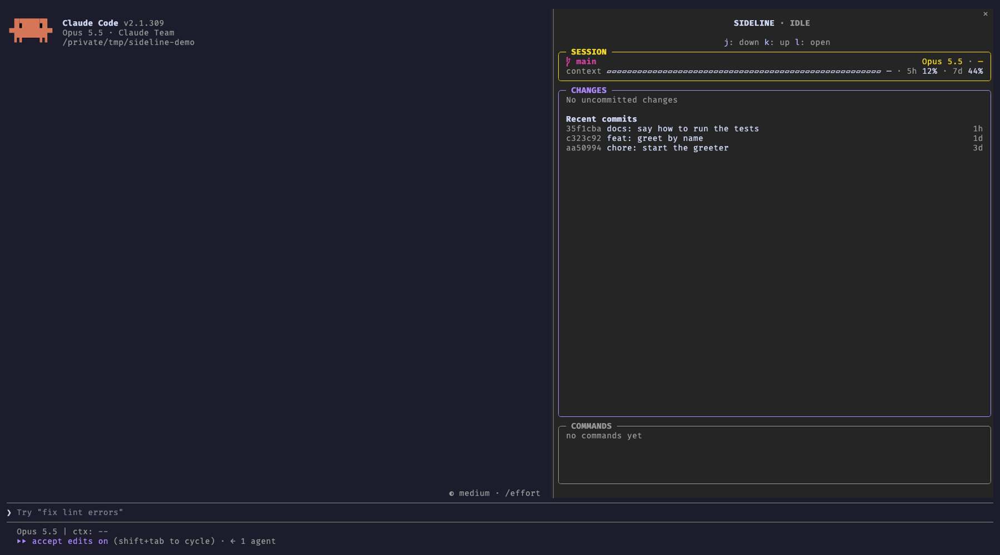

<h1 align="center">sideline</h1>

<p align="center">
  Keeps Claude Code's conversation clean, and puts the details to the side
</p>

<p align="center">
  <a href="https://code.claude.com"></a>
  
  
  <a href="https://github.com/artberri/sideline/actions/workflows/check.yml"></a>
  <a href="LICENSE"></a>
</p>

<p align="center">
  
</p>

> [!NOTE]
> sideline is a Claude Code **mod** and needs **Claude Code 2.1.308 or newer**. In the terminal its pane docks beside
> the conversation in the fullscreen layout (`/tui fullscreen`); it opens by itself on a terminal at least 144 columns
> wide, and `/sideline` toggles it at any width. Claude Code Desktop docks it on its own. VS Code and the mobile app
> aren't supported yet: the pane doesn't open there by itself, and `/sideline` opens a version that isn't laid out
> for them and can't be clicked. The transcript tidying doesn't depend on the pane.

---

Claude's conversation fills up with things you rarely read: whole shell scripts, every edit's diff, "Ran 1 shell
command" lines. sideline clears them out, so the conversation reads as what Claude said and did, and keeps the details a
glance away, in a pane at its side:

- a described shell command shows its description, not the whole script;
- an edit is one line with its counts, `Update(src/greet.js) (+4 -0)`, not the diff;
- finished "Ran 1 shell command" and "Read 2 files" lines go.

ctrl+o still shows everything, and each of these can be turned off.

The pane stacks a `SIDELINE · IDLE / WORKING / WAITING` title and the key hints over three boxes:

- **SESSION**: the branch with [Starship](https://starship.rs)-style git status symbols, the model and effort, a
  context bar, and your 5-hour and 7-day usage.
- **CHANGES**: a tree of the changed files with `+N -N` counts, a shimmer on the file Claude is editing, and each
  file's diff a click (or `l`) away. With nothing changed, it lists the recent commits, and each opens as its own tree
  and diffs. It scrolls with the wheel and the keys.
- **COMMANDS**: the latest shell commands Claude ran, `●` running, `✓` done, `✗` failed; click one to read it whole.

## Install

sideline is in the [artberri marketplace](https://github.com/artberri/claude-plugins). Add it once, then install:

```sh
claude plugin marketplace add artberri/claude-plugins
claude plugin install sideline@artberri
```

or, inside a Claude Code session, `/plugin marketplace add artberri/claude-plugins` and
`/plugin install sideline@artberri`.

The pane opens by itself on a wide enough terminal and in Claude Code Desktop. `/sideline` toggles it (`/sideline open`
and `/sideline close` do one or the other); once you close it, it stays closed for the session until you open it
again. The transcript stays tidy either way.
Focus it with ctrl+x tab (the `abovePrompt:focus` keybinding), then use the keys in its hint line: `j`/`k` to move,
`l` to open, `h` to go back, `c` for the commands box.

## Options

Set them in `/config`, or under `pluginConfigs` → `sideline` → `options` in your settings.

| Option               | Default | What it does                                                                                      |
| -------------------- | ------- | ------------------------------------------------------------------------------------------------- |
| `glyphs`             | `auto`  | `auto` uses Nerd Font icons when a Nerd Font is installed; `nerd` or `plain` forces one set.      |
| `background`         | (empty) | A `#hex` colour to paint the pane with, such as your terminal's background.                       |
| `transcriptDiffs`    | `hide`  | `hide` folds an edit's diff into its counts; `show` keeps Claude Code's diffs.                    |
| `transcriptCommands` | `hide`  | `hide` shows a described command's description and drops finished group lines; `show` keeps them. |
| `sessionBox`         | `show`  | `hide` drops the SESSION box and puts the branch line back in CHANGES.                            |
| `commandRows`        | `5`     | How many commands the COMMANDS box shows, 0 to 20; `0` hides it.                                  |

The file icons need [Nerd Fonts](https://www.nerdfonts.com) 3.0 or later; with an older one, or none, set `glyphs` to
`plain`.

## What it can see and do

sideline only watches and reads, and nothing it sees leaves your machine. Every hook passes its event on unchanged: it
never approves, refuses or edits a tool call or a prompt, and adds nothing to what Claude sees.

| It sees                                                    | Through                                                                                                 |
| ---------------------------------------------------------- | ------------------------------------------------------------------------------------------------------- |
| each tool call's name and input, and whether it failed     | `tool.call`                                                                                             |
| when a main turn starts and ends, and its model and effort | `turn.start`, `turn.step`, `turn.complete`                                                              |
| context and rate-limit readings                            | `session.measure`, `$.session.usage()`                                                                  |
| the repo's status, diffs and recent commits                | read-only `git` (`status`, `diff`, `diff-tree`, `show`, `log`, `rev-parse`, with `--no-optional-locks`) |
| untracked files' sizes and times, to count their lines     | `stat`                                                                                                  |
| your OS and installed fonts, to choose its icons           | `uname -s`, `fc-list` or the macOS Fonts folders                                                        |

It never writes a file, commits, stages or pushes, makes no network requests, calls no model and has no dependencies;
everything it keeps is session state in Claude Code. What it hides in the transcript (long commands, diffs, finished
count lines) is display only: the full command is in the `COMMANDS` box, permission prompts still show it whole,
ctrl+o shows everything, and the `transcriptCommands` and `transcriptDiffs` options turn the hiding off.
`claude plugin validate .` prints exactly what it hooks and calls.

### What it sends

Nothing, to anywhere. Its only way out of Claude Code is `$.process.run`, and it runs just these fixed, local
commands, none of which reaches the network:

- `git`, read-only, to draw the changes, diffs and commits (the full list is below);
- `uname -s`, once per session, to draw Claude Code's own row dot (`⏺` on macOS, `●` elsewhere);
- `fc-list :charset=e0a0 file`, once per session with `glyphs` on `auto`, to find a Nerd Font. Without `fc-list`, as on
  a stock macOS, it reads the file names in `$HOME/Library/Fonts` and `/Library/Fonts` instead (`$.fs.list`).

It runs no shell.

Each `git` command starts `git --no-optional-locks -C <folder>`, runs with `GIT_OPTIONAL_LOCKS=0` and a 10-second
timeout, and is one of these:

```sh
status --porcelain=v2 --branch -z --untracked-files=all       # the changed files and the branch
rev-parse --show-toplevel                                      # the repo's root
rev-parse --verify --quiet refs/stash                          # whether there is a stash
diff HEAD --numstat -z                                         # tracked files' line counts
diff --no-index --numstat -z -- /dev/null <untracked file>     # an untracked file's line counts
log -n50 --format=%h%x00%s%x00%ct%x00                          # the recent commits, with nothing changed
diff HEAD -- <file>                                            # a changed file's diff
diff --no-index -- /dev/null <untracked file>                  # an untracked file's diff
diff-tree -r --root --no-commit-id -m --first-parent --numstat -z <commit>      # a commit's line counts
diff-tree -r --root --no-commit-id -m --first-parent --name-status -z <commit>  # a commit's files
show --format= -m --first-parent <commit> -- <file>            # a file's diff in a commit
```

`<folder>` is the session's working folder or its repo's root; `<file>` and `<untracked file>` are paths `git status`
(or, in a commit, `diff-tree`) listed; `<commit>` is a hash `git log` listed. Nothing you or Claude type goes into a
command.

From the conversation it reads only what the table above lists: `turn.step` gives it the model and effort of each
main request, never the messages, and `tool.call` gives it each tool call's name, input and outcome, which it draws in
the pane (a shell command in `COMMANDS`, an edited file's shimmer in `CHANGES`). None of it goes into a command or
leaves Claude Code.

What `stat` reads, an untracked file's size and modification time, only decides whether `git` counts that file's lines
again; it goes into no command and is kept only for the session. Everything these commands print is drawn in the pane
and nowhere else.

## Troubleshooting

**The pane doesn't appear.** Check `claude --version` is 2.1.308 or later, then run `/reload-plugins` and `/sideline`.
Below 144 columns Claude Code doesn't open a pane nobody asked for, so `/sideline` is needed there. Look in the
transcript for a dim line starting `sideline:`: it names the hook that failed; please
[open an issue](https://github.com/artberri/sideline/issues) with it.

**The pane doesn't open in VS Code or the mobile app.** That's on purpose: sideline isn't laid out for them yet, so it
only opens on its own in the terminal and in Claude Code Desktop.

**Icons draw as boxes or blanks.** The file icons need Nerd Fonts 3.0 or later: update your Nerd Font, or set
`glyphs` to `plain`.

**The pane is grey.** Claude Code draws docked panes on its own grey; set `background` to your terminal's background
colour, for example `#1e1e3f`.

**I want to see the full command or diff in the conversation.** ctrl+o shows everything; set `transcriptCommands` or
`transcriptDiffs` to `show` to keep them there.

## Contributing

See [CONTRIBUTING.md](CONTRIBUTING.md). sideline learned from
[claude-code-filetree](https://github.com/data-goblin/claude-code-filetree) and
[claude-flightdeck](https://github.com/scasella/claude-flightdeck); see [ACKNOWLEDGEMENTS.md](ACKNOWLEDGEMENTS.md).

## Licence

[MIT](LICENSE)
